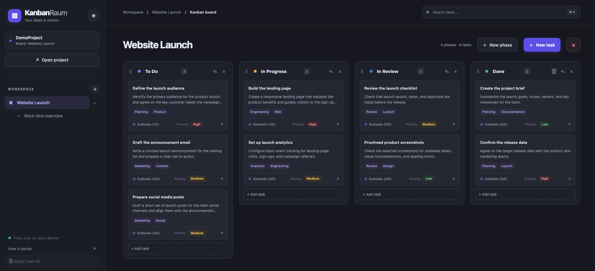

  
  <h1 style="font-family: -apple-system, BlinkMacSystemFont, 'Segoe UI', sans-serif; font-weight: 800; letter-spacing: -0.9px;">KanbanRaum</h1>
  
<b><i>KanbanRaum</i></b> (German for “KanbanSpace”) is a private, file-based Kanban app for organizing projects and work. Built with HTML, CSS, and JavaScript, it needs no database or server and keeps your boards and tasks as regular files on your device.

  

---

## A board for every project

- **Organize your workspace** with boards, phases, and work items.
- **Keep work in order** by dragging cards between phases and reordering tasks or phases.
- **Write in Markdown** with clickable links that open in a new tab.
- **Add tags and priorities** and filter the work-item overview by phase, priority, and tag.
- **Track the details** with subtasks, comments, and file attachments.
- **Undo with care:** deleted work items and boards go to the trash before permanent removal.
- **Make it yours** with light and dark themes. KanbanRaum can remember your last workspace and board.
- **Add your language:** English and German are included. Add more languages by translating `languages/default.js`.

## Get started

No installation is required. Just download KanbanRaum and open `index.html` in your browser, click **Connect Folder** and choose the folder where you want to store your notes (could also be a cloud storage if you want to sync). No server is required.

> **Browser support:** KanbanRaum currently supports only Google Chrome and Microsoft Edge browsers. Firefox and Safari are not supported because the app requires the File System Access API.

Use the `DemoProject/` demo folder to try out the app or use a <a href="https://patricklangx.github.io/app/KanbanRaum/index.html" target="_blank">live demo</a>.